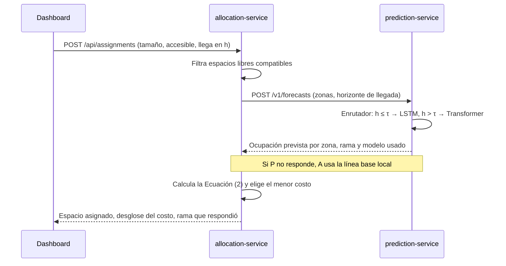

# Asignación dinámica de parqueaderos con predicción híbrida

Prototipo del proyecto de Arquitectura Empresarial (AREP) de la Escuela Colombiana de Ingeniería Julio Garavito.
Implementa el alcance de la Sección 7 del paper: el motor predictivo híbrido (Módulo 4), el motor de asignación
reducido (Módulo 5) y una versión reducida de los módulos 2 y 3.

## Autores

- **Juan Lozano**
- **Sebastian Albarracin**
- **Adrian Ducuara**

> **Los datos actuales son simulados.** `prediction-service/parking_ml/simulator.py` genera series con supuestos
> plausibles de horario y capacidad. Las métricas describen ese simulador y **no validan las hipótesis sobre la
> ECI**. Para validarlas hay que entrenar con datos de campo (ver [Usar datos reales](#usar-datos-reales)).

---

## El problema

En un campus universitario la demanda de parqueadero no es constante. Se concentra en momentos predecibles,
como la llegada a primera hora y los cambios de bloque de clases, y en esos picos algunas zonas se llenan
mientras otras quedan con espacio.

Hoy el conductor decide solo con lo que ve: entra a la zona más cercana a su destino y, si está llena, da vueltas
buscando otra. Esto genera tres problemas:

1. **Decisiones reactivas.** Un espacio que está libre ahora puede estar lleno cuando el conductor llega. Nadie
   anticipa la ocupación de los próximos minutos u horas.
2. **Carga desbalanceada.** Todos van a la misma zona "buena" y saturan su vía de acceso, mientras la periferia
   queda subutilizada.
3. **Necesidades no atendidas.** Los espacios accesibles o para vehículos grandes no se asignan con ningún criterio
   explícito.

## La solución

Proponemos un sistema que, cuando un vehículo solicita espacio, **predice la ocupación de cada zona en el momento
en que el vehículo va a llegar** y asigna el espacio que minimiza un costo que combina varios criterios.

### 1. Predicción híbrida de ocupación

Dos redes neuronales complementarias pronostican la ocupación de cada zona:

| Rama | Cómo lee la historia | Para qué horizonte |
|---|---|---|
| **LSTM con atención** | Hora por hora y en orden, con memoria; la atención pondera los pasos de la ventana | Corto plazo (h ≤ τ) |
| **Transformer** | Las 24 horas a la vez, con autoatención y atención cruzada desde el instante objetivo | Largo plazo (h > τ) |

Un **enrutador** elige la rama según el horizonte de predicción `h` y un umbral `τ`. Ambas ramas reciben una
ventana de 24 h con 11 variables por hora (ocupación, entradas, salidas, cambio de clases, día sin clases, lluvia,
hora y día codificados de forma cíclica, fin de semana) y el contexto conocido del instante objetivo. Las dos
exponen sus **pesos de atención**, lo que permite ver qué horas del pasado influyeron en cada predicción.

Si una rama falla o su error en producción supera un límite, el enrutador la reemplaza por una **línea base**: la
ocupación de la misma hora una semana antes.

### 2. Asignación por función de costo (Ecuación 2)

Para cada espacio libre y compatible se calcula:

```text
Costo = α·D + β·T + γ·C + δ·I + ε·A + ζ·S
```

| Término | Significado | Peso inicial |
|---|---|---|
| D | Distancia al destino | α = 0,25 |
| T | Tiempo estimado de llegada, que crece con la congestión | β = 0,20 |
| C | Congestión de la vía de acceso a la zona | γ = 0,15 |
| I | Inadecuación de tamaño (p. ej., un carro mediano en un espacio grande) | δ = 0,10 |
| A | Penalización de accesibilidad | ε = 0,10 |
| **S** | **Saturación prevista de la zona al llegar**, que viene del motor predictivo | ζ = 0,20 |

Se asigna el espacio de menor costo. Los pesos son de juicio experto (`application.yml`) y no se ajustaron con
datos, como indica la Sección 7.1. Dos reglas son duras y no dependen del costo: un vehículo nunca recibe un
espacio más pequeño que él, y un espacio accesible nunca se asigna a quien no lo necesita.

---

## Arquitectura

### Vista de componentes

```text
Navegador ──> nginx (dashboard estático)                          :8088
                ├── /api ──> allocation-service (Spring Boot)     Módulos 3 y 5
                │              ├─ DigitalTwin / OccupancyHistory   estado e histórico
                │              ├─ CostFunction / AllocationService  Ecuación (2)
                │              ├─ ScenarioService                   escenarios A-D
                │              ├─ AllocationExperiment              Hipótesis 3
                │              ├─ ObservabilityService              previsto vs. observado
                │              └─ ForecastGateway ──HTTP──┐         línea base si no hay respuesta
                └── /ml ───> prediction-service (FastAPI) <┘        Módulo 4
                               ├─ router: h ≤ τ → LSTM, si no → Transformer
                               ├─ BranchHealth: caídas y error móvil
                               └─ artifacts/: modelos versionados y registro
```

| Servicio | Tecnología | Responsabilidad |
|---|---|---|
| `dashboard` | HTML, CSS y JS sin framework, servido por nginx | Plano del parqueadero, escenarios, pronósticos, evaluación y operación |
| `allocation-service` | Java 17, Spring Boot 3.5 | Gemelo digital del parqueadero, función de costo, escenarios, experimento H3 y observabilidad |
| `prediction-service` | Python 3.11, FastAPI, PyTorch | Inferencia LSTM/Transformer, enrutador, salud de ramas y registro de modelos |
| `data/` | CSV y JSON | Series de ocupación (15 min y 1 h) y definición de zonas |

### Flujo de una asignación



### Decisiones de arquitectura (Sección 4.4)

| Decisión | Dónde está |
|---|---|
| Inferencia desacoplada tras una API única | `POST /v1/forecasts`; Spring solo conoce el puerto `PredictionClient` |
| Modelos versionados | `artifacts/registry.json`: versión, hash de datos y MAE por rama y horizonte |
| Degradación controlada | `BranchHealth` y `ForecastGateway`: rama caída, error sobre el límite o servicio caído |
| Presupuesto de latencia | Inferencia sobre series agregadas; cada respuesta informa su latencia |
| Observabilidad | `ObservabilityService` compara lo previsto con lo observado y lo reporta al enrutador |
| Alcance del modelo | Un modelo global por rama y horizonte, con la zona como entrada |

### Decisiones de implementación que conviene conocer

- **Umbral τ.** El servicio arranca con τ = 1 h, la política inicial de la Tabla 2 (variable `ROUTER_TAU`). El valor
  calibrado con validación se guarda en `artifacts/registry.json` y es el que usa el reporte de H2. El dashboard
  permite cambiar el τ activo en vivo.
- **Horizontes intermedios.** Hay modelos para 1, 3, 5, 8, 12 y 24 h. Otros valores se interpolan linealmente
  entre los dos horizontes vecinos; por debajo de 1 h se interpola desde la ocupación observada.
- **Saturación a corto plazo.** Con h ≤ 1 h, S es el máximo entre lo previsto y la ocupación actual.
- **Accesibilidad.** Quien necesita un espacio accesible recibe uno si queda alguno.
- **Espacios individuales.** Los datos solo traen conteos por zona; qué espacio concreto está ocupado se fija de
  forma reproducible. El plano y sus distancias son ilustrativos.

### Estructura del repositorio

```text
├── allocation-service/      Spring Boot: asignación, gemelo digital, experimento H3
├── prediction-service/
│   ├── app/                 API FastAPI, motor de inferencia y enrutador
│   ├── parking_ml/          simulador, features, modelos, entrenamiento y métricas
│   ├── artifacts/           12 modelos entrenados (.pt), registry.json y report.json
│   └── tests/               pruebas de la API y del pipeline de ML
├── dashboard/               interfaz web y configuración de nginx
├── data/                    series de ocupación y zonas
└── docker-compose.yml
```

---

## Cómo probarlo

### Ejecutar el sistema

Requisito: Docker Desktop encendido.

```bash
docker compose up --build
```

Abrir <http://127.0.0.1:8088>. Los modelos entrenados y los datos ya están en el repositorio, así que no hace
falta GPU. La primera construcción descarga PyTorch y puede tardar varios minutos. Para detenerlo:
`docker compose down`.

### Recorrido de prueba en el dashboard

| Paso | Qué hacer | Qué se debe ver |
|---|---|---|
| 1 | Clic en **A · Baja demanda** | Domingo en la tarde: se asigna el espacio más cercano (A-002) y responde el LSTM |
| 2 | Clic en **B · Cambio de clases** | El vehículo llega en 4 h. La Zona A está vacía ahora pero se prevé al ~90%, así que se asigna la Zona E y responde el Transformer |
| 3 | Clic en **C · Congestión localizada** | La vía a la Zona A está congestionada y gana un espacio de la Zona B |
| 4 | Clic en **D · Necesidad especial** | Se asigna un espacio accesible en la zona con menor saturación prevista |
| 5 | **Pronóstico por horizonte**: cambiar zona y "Atención a" | Ocupación prevista contra observada y pesos de atención sobre la ventana de 24 h |
| 6 | **Evaluación** → **Ejecutar simulación** | Veredictos de H1, H2 y H3, y MAE por horizonte |
| 7 | **Operación** → **Simular caída** del LSTM y repetir A | La asignación sale "con degradación controlada" y responde la línea base |
| 8 | **Inyectar deriva** → **Comparar previsto y observado** | El MAE observado supera el límite y la rama sale de servicio |
| 9 | `docker compose stop prediction` y asignar | El sistema sigue asignando y el dashboard muestra el servicio de inferencia caído |
| 10 | `docker compose start prediction` y **Restablecer ramas** | Todo vuelve a la operación normal |

### Probar la API directamente

```bash
# Cargar un escenario y pedir un espacio
curl -X POST http://127.0.0.1:8088/api/scenarios/B
curl -X POST http://127.0.0.1:8088/api/assignments -H "Content-Type: application/json" \
     -d '{"size":"MEDIUM","needsAccessible":false,"arrivalInHours":4}'

# Salud y modelos del servicio de predicción
curl http://127.0.0.1:8088/ml/health
curl http://127.0.0.1:8088/ml/v1/models

# Experimento de la Hipótesis 3
curl -X POST http://127.0.0.1:8088/api/experiments/allocation -H "Content-Type: application/json" -d '{}'
```

| Servicio | Endpoints principales |
|---|---|
| allocation (`/api`) | `GET /state`, `PUT /clock`, `POST /reset`, `POST /scenarios/{id}`, `POST /assignments`, `GET /forecasts`, `POST /experiments/allocation`, `POST /observability/backtest` |
| prediction (`/ml`) | `GET /health`, `POST /v1/forecasts`, `POST /v1/feedback`, `GET /v1/models`, `GET /v1/report`, `POST /v1/admin/branches/{rama}`, `POST /v1/admin/branches/{rama}/drift`, `POST /v1/admin/router`, `POST /v1/admin/reset` |

### Pruebas automatizadas

```bash
cd prediction-service
py -3.11 -m venv .venv
.venv/Scripts/pip install torch --index-url https://download.pytorch.org/whl/cu128
.venv/Scripts/pip install -r requirements-dev.txt
.venv/Scripts/python -m pytest          # API y pipeline de ML

cd ../allocation-service
mvn test                                # función de costo y servicio de asignación
```

### Regenerar datos y modelos

```bash
cd prediction-service
.venv/Scripts/python -m parking_ml.simulator --out ../data --weeks 18 --seed 7
.venv/Scripts/python -m parking_ml.train --data ../data/occupancy_15min.csv --out artifacts
```

---

## Protocolo de evaluación

- Partición cronológica 70/15/15 por instante objetivo; ventana de 24 h, como en Vakrinou et al.
- Cada rama y horizonte se entrena con 3 semillas; se publica la de menor MAE en validación.
- τ se elige solo con validación entre 0 (todo Transformer) y 24 (todo LSTM). Prueba se usa únicamente para reportar.
- MAPE, MAE, MSE y R² por horizonte. El MAPE omite ocupaciones reales menores al 5%.
- Importancia por permutación por variable en `artifacts/report.json`. SHAP no está implementado.
- **H3:** en las horas pico del periodo de prueba se comparan cuatro políticas con los mismos vehículos: vecino más
  cercano, costo sin saturación, costo con ocupación actual y costo con predicción. Una asignación es *adecuada* si
  respeta tamaño y accesibilidad y la zona no supera el 90% al llegar. El tiempo incluye recorrido y una cola por
  zona con servicio de 15 s por vehículo; ambos valores son supuestos del simulador.

### Resultados con datos simulados

| Modelo | MAE promedio (fracción de capacidad) | R² |
|---|---|---|
| Línea base (misma hora, semana anterior) | 10,4% | 0,58 |
| LSTM con atención | 4,2% | 0,94 |
| Transformer | 4,0% | 0,94 |
| Enrutador (τ calibrado = 0) | 4,0% | 0,94 |

| Hipótesis | Resultado | Lectura |
|---|---|---|
| **H1.** Existe un horizonte τ desde el cual el Transformer supera al LSTM | ✓ con matices | El Transformer solo gana de forma sostenida a 24 h |
| **H2.** El enrutador supera a cada rama por separado | ✗ | Con τ = 0 el enrutador equivale al Transformer |
| **H3.** Asignar con predicción mejora al vecino más cercano en hora pico | ✗ | 79,8% de asignaciones adecuadas contra 80,5%, y unos 6 s más por vehículo |

Ambas redes reducen el error a menos de la mitad frente a la línea base. Sin embargo, con este simulador ni el
enrutador ni la asignación predictiva muestran ventaja. Estas hipótesis deben evaluarse de nuevo con datos reales
del parqueadero de la ECI.

## Usar datos reales

El CSV debe tener `timestamp, zone, occupied, capacity` y, de forma opcional, `inflow, outflow, class_change,
no_class_day, rain`. Acepta resolución de 15 minutos o una hora y rechaza huecos, duplicados y ocupaciones imposibles.

```bash
cd prediction-service
.venv/Scripts/python -m parking_ml.train --data ../data/mis_datos.csv --out artifacts --dataset-kind field
```

Antes de entrenar, borre `data/zones.json` si no corresponde a sus zonas: el entrenamiento solo crea ese archivo si
no existe. El plano admite cualquier número de zonas, y con `field` desaparece el aviso de datos simulados.

## Fuera de alcance

Clasificación vehicular, navegación interna con recálculo, aplicación móvil y módulo de administración completo
(Sección 7.1). Tampoco hay autenticación: los endpoints administrativos solo se publican en `127.0.0.1`, por lo
que este despliegue no debe exponerse a una red.
